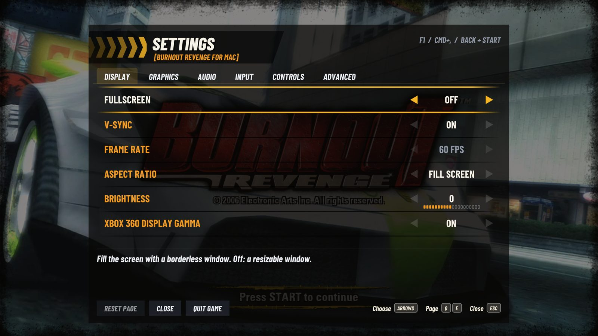
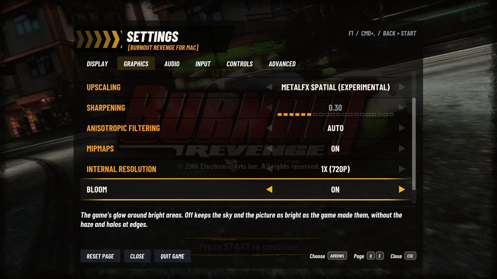
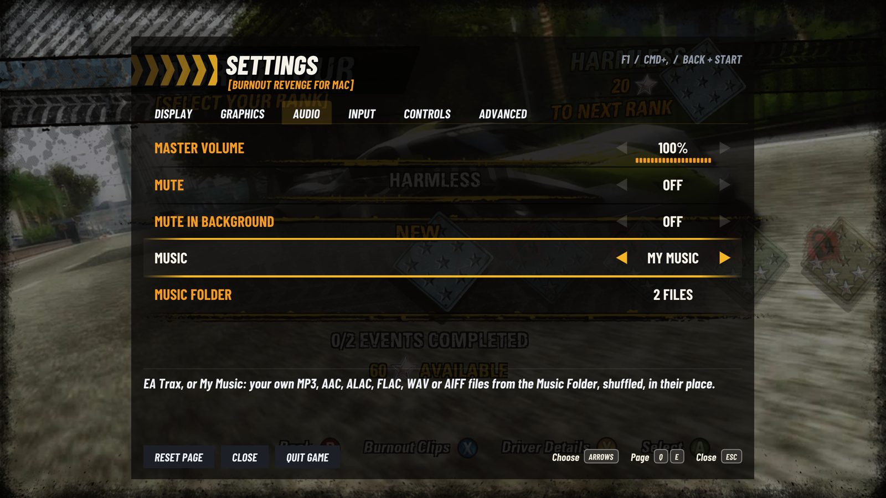
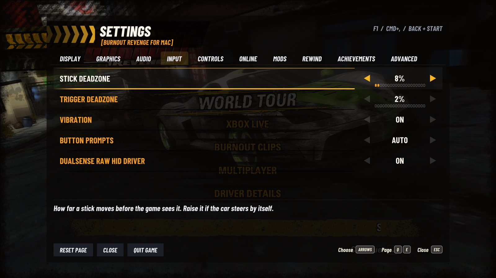

  

<h1 align="center">Burnout Revenge for Mac</h1>

  An unofficial native port of <i>Burnout Revenge</i> (Xbox 360, USA) for Apple silicon Macs. 
  The game's PowerPC code is recompiled ahead of time into an arm64 program; graphics run on Metal through Vulkan/MoltenVK. 
  You bring the game from your own disc.

  <a href="https://github.com/secretpray/burnout-revenge/releases/latest"><b>Download</b></a>
  &nbsp;·&nbsp;
  <a href="#quick-start">Quick start</a>
  &nbsp;·&nbsp;
  <a href="#highlights">Highlights</a>
  &nbsp;·&nbsp;
  <a href="#settings">Settings</a>
  &nbsp;·&nbsp;
  <a href="CHANGELOG.md">Changelog</a>
  &nbsp;·&nbsp;
  <a href="docs/BUILD.md">Build</a>

> [!IMPORTANT]
> This is a non-commercial fan project, not affiliated with or endorsed by
> Electronic Arts, Criterion Games, Microsoft, Sony or Apple. No game data is
> included or distributed: no disc image, extracted files, add-on packs, music
> or generated PPC sources. You need your own USA Xbox 360 disc image. Please do
> not ask for game files or attach them to issues.

  

<table>
  <tr>
    <td width="50%"> The crash camera.</td>
    <td width="50%"> A near miss, with your own music playing.</td>
  </tr>
  <tr>
    <td width="50%"> Replay after a race, in a wider-than-16:9 window.</td>
    <td width="50%"> Wide windows show more of the road (Hor+).</td>
  </tr>
  <tr>
    <td width="50%"> Bloom off, the sky kept; the game's prompts for a DualSense.</td>
    <td width="50%"> Split screen for two, a controller each.</td>
  </tr>
</table>

Unedited screenshots from this port on an M1 Pro. The game content in them belongs to its owners.

**TL;DR**

- The original 2006 Xbox 360 game runs as a native Mac app: its own cars, tracks,
  physics, menus, EA Trax and saves. Nothing is remastered; the extras are
  options on top.
- Compared with the console: up to 4K internal resolution, SMAA or FXAA,
  FSR 1 or MetalFX upscaling, 16x anisotropic filtering, any window shape,
  your own music instead of EA Trax, keyboard play and save backups.
- [Download](https://github.com/secretpray/burnout-revenge/releases/latest) the DMG, drag the app to
  Applications, open it and choose your disc image. It checks and installs the
  game, then you play.
- Updates install over the old version. Saves and settings stay.
- Settings: **F1**, **Cmd+,** or **Back + Start** on a controller.

## Highlights

**Picture**

- Internal resolution from 1x (720p, as on the console) to 3x (2160p). Auto
  picks it from the size of the window.
- SMAA 1x (default) or FXAA anti-aliasing. SMAA keeps text, number plates and
  textures sharper for about 0.4 ms more GPU time at 1080p.
- Upscaling with Bicubic, Bilinear, AMD FSR 1 or Apple MetalFX Spatial
  (experimental), with adjustable sharpening.
- Up to 16x anisotropic filtering, mipmaps, a brightness control and the Xbox
  360's own display gamma ramp.
- Any window shape: a wider window shows more at the sides (Hor+), a taller one
  (16:10, 4:3) more above and below (Vert+), with the HUD kept in shape. On
  either (21:9, 32:9, 16:10, 4:3) the race HUD sits at the screen's corners and
  the menus' frame at its edges; menus and films stay 16:9 in the middle.
  Widescreen keeps the original 16:9 with bars.
- Vehicle Detail: rivals and traffic keep their detailed models twice as far
  away by default (Far), or four times (Farthest), so cars ahead stop
  changing shape as you close in. Original is the console's 30 m.
- Bloom and Motion Blur from 0 to 100%. Lower Bloom removes the game's haze
  and the glow round edges but keeps its bright blue sky: the glow is kept where
  it comes from rather than switched off. Lower Motion Blur shortens the streaks
  at speed; 0% keeps speed sharp.
- The game's own menu clicks in the Settings menu and the first-run screens,
  read from your copy of the game.
- 60 fps, as the console. Fullscreen, V-Sync, and Cmd+H and Cmd+Tab that work
  in fullscreen. On an external 144 or 165 Hz monitor, a one-time note says how
  to set it to a rate 60 fps divides evenly.

**Sound and music**

- The game's own engines, crashes and EA Trax, decoded from your disc.
- **My Music**: Settings > Audio > Music plays your own MP3, AAC, ALAC, FLAC,
  WAV or AIFF files instead of EA Trax, shuffled, with a "Now playing" notice
  naming each song. The game's pauses, fades and crash silence apply to them.
- The game's sound steps back while the settings menu is open. Mute, Mute in
  Background and a master volume.

**Online**

- Xbox Live play again, off by default (Settings > Online): races, Road Rage,
  Crash Party, Crash Tour and Crash Battle with up to four players, and
  Burnout Clips shared, watched and downloaded. Meet on the Xerenge community
  server, a server of your own (it comes inside the app) or the local network
  with no server. Ranked matches can be hosted and joined too, without a
  global ranking or TrueSkill service. Not yet tested between two Macs: see
  [docs/ONLINE.md](docs/ONLINE.md). Xbox Live friends, messages, player reviews
  and gamer cards are unavailable; their buttons leave the game running.

**Offline Codes**

- Settings > Codes, each off by default and applied live, solo World Tour only:
  **Infinite Boost** (full bar at level 4), **Infinite Time** (event countdown
  stopped), **Quick Money** (at least $30,000 per Traffic Attack award),
  **Quick Takedowns** (99 event Takedowns after the first real one) and
  **Easy Boost** (a Near Miss fills the bar). Career progress saves normally,
  so results earned with Codes stay in your career.
  The game hook blocks them in local Multiplayer, Crash, clips and every run
  with Online Play enabled. To use them, turn Online Play off and restart the game.
  [Behavior and limits](docs/CODES.md).

**Controls**

- Xbox controllers and DualSense through SDL, with vibration. Back + Start
  (Share + Options on a DualSense) opens the settings anywhere.
- Split-screen Multiplayer for two: each controller is a player, in the
  order they connect, with its own vibration.
- USB steering wheels (Logitech G29 and its family): wheel, pedals, buttons
  and Settings > Wheel with a Calibrate row; force feedback where the
  system can drive the wheel.
- Full keyboard play. Every Xbox 360 control can take two keys, remapped in
  the Controls page; bindings are physical keys, so they work on any layout.
- Button prompts follow the device you use, in the port's menus and in the
  game's own (menus, Replay, "PRESS TO BOOST!"): PlayStation shapes with a
  DualSense, your keys as Mac key caps with the keyboard, Xbox buttons
  otherwise. Settings > Input > Button Prompts can keep one set.

**A menu in the game's own style**

- A settings menu modelled on the game's Settings screen: its fonts, its
  orange rows and yellow bands, its running chevrons and button hints. Every
  change applies live, and each row explains itself.
- Dialogs, notices and the "What's new" note look like the game's own prompts.

**Setup and saves**

- A first-run setup in the game's style: choose your ISO, and all 802 files are
  checked against the supported release before anything is installed. EA Trax
  from your own disc plays while it installs. Cancelled, failed or cut short
  by a crash, an install leaves nothing behind: no partial copy, no empty
  folders.
- Add-on car packs: choose a folder at setup, import later from Settings, or
  let the game find `XBOX360/454107DC/00000002` on a mounted drive.
- Saves can't be half-written: a save is written to a copy and put in
  place whole once the game finishes it, so a crash or power cut mid-save
  leaves the previous save.
- Save backups: each launch backs up your saves when they changed (the newest
  10 are kept). Settings > Advanced > Save Backups restores one.
- Save import: Save Backups > Import Save File / Import Save Folder (or
  `--import-save <path>` with the game closed) brings in a save from an Xbox 360
  (its save package, e.g. `Content/<profile>/454107DC/00000001/` on a USB stick),
  from Xenia's content folder, or the game's `Player Files`. Your current saves
  are backed up first; the import applies at the next launch.
- A finished save (Elite rank, every event and all 86 cars) comes with each
  release from v0.1.10 as `BurnoutRevenge-100-percent-save.zip`: unzip it and
  import its `Player Files` as above. It's a save shared online for the USA
  game; only its progress file is included, without the original profile.
- Skip Intro Movies (on by default): the title screen in about 8 seconds.
- Save Bug Report gathers the logs and settings into one file; Check for
  Updates asks GitHub for a newer release.

## Quick start

1. Download **BurnoutRevenge-x.y.z-macos.dmg** from
   [Releases](https://github.com/secretpray/burnout-revenge/releases/latest) and drag
   **Burnout Revenge.app** to Applications.
2. Open it. The app is signed ad hoc, not notarized: if macOS blocks it, use
   System Settings > Privacy & Security > Open Anyway.
3. Choose your **USA Xbox 360 disc image** (.iso). Optionally choose an install
   folder and your add-on car packs, then Install & Verify.
4. Start your engines. Later launches go straight to the game.

  
   
  The download: drag the game to Applications.

<table>
  <tr>
    <td width="25%"> 1. Your game.</td>
    <td width="25%"> 2. Setup.</td>
    <td width="25%"> 3. Install, every file verified.</td>
    <td width="25%"> Ready.</td>
  </tr>
</table>

Settings, saves and the installed game live in
`~/Library/Application Support/BurnoutRevenge`; shader caches in
`~/Library/Caches/BurnoutRevenge`.

**Requirements:** an Apple silicon Mac with macOS 15 or later, and the USA
Xbox 360 disc image of Burnout Revenge. Developed and tested on an M1 Pro.
PAL and Japanese discs, title updates, GOD packages and Xbox save imports are
not supported.

## Settings

Open with **F1**, **Cmd+,** or **Back + Start**. LB/RB (Q/E) switch pages.

<table>
  <tr>
    <td width="50%"> Display.</td>
    <td width="50%"> Graphics, Vehicle Detail.</td>
  </tr>
  <tr>
    <td width="50%"> Audio, with My Music.</td>
    <td width="50%"> Input, Button Prompts.</td>
  </tr>
</table>

| Page | What's there |
|---|---|
| Display | Fullscreen, V-Sync, Frame Rate, Aspect Ratio (fill any window, or 16:9), HUD at Screen Edges (not 16:9), Brightness, Xbox 360 Display Gamma |
| Graphics | Anti-Aliasing and its type (SMAA, FXAA), Upscaling (Bicubic, Bilinear, FSR 1, MetalFX Spatial), Sharpening, Anisotropic Filtering, Mipmaps, Internal Resolution, Bloom, Motion Blur, Vehicle Detail |
| Audio | Master Volume, Mute, Mute in Background, Music (EA Trax or My Music), Music Folder |
| Input | Stick and trigger deadzones, Vibration, Button Prompts (Auto, Xbox, PlayStation, Keyboard), DualSense raw HID driver |
| Wheel | Shown while a steering wheel is plugged in: Steering Wheel, Steering Range, Invert Steering, Steering Deadzone, Steering Response, Force Feedback, Centering Force, Calibrate |
| Controls | Two keys for each Xbox 360 control |
| Online | Online Play, Server (Xerenge Community, My Server, LAN), Gamertag, Server Address, Check Server ([online play](docs/ONLINE.md)) |
| Codes | Infinite Boost, Infinite Time, Quick Money, Quick Takedowns, Easy Boost; solo World Tour only, off by default |
| Advanced | Asynchronous Shaders, Performance Overlay, Auto-import Add-ons, Skip Intro Movies, Save Bug Report, Check for Updates, Add-ons, Save Backups, About |

A good start on an M1 Pro: 1.5x internal resolution (1080p), SMAA, Bicubic,
sharpening 0.3 and 16x anisotropic filtering. Use 1x if the GPU can't keep
60 fps.

  
   
  My Music in the main menu. Song names in any script are shown.

### Keyboard

| Action | Keys |
|---|---|
| Accelerate / brake | W / S (right / left trigger) |
| Steer | A / D or the arrows |
| Boost (A) | Space |
| B / X / Y | Backspace / Left Shift / Left Control |
| Shoulders (LB / RB) | Q / E |
| Start | Return |

Every key can be changed in Settings > Controls.

## Known limits

- Tested on one M1 Pro with its own controllers; other Macs and accessories
  may behave differently. USB is the fallback for a Bluetooth pad.
- Steering wheels are tested on a virtual Logitech G29 only, not yet on a
  real wheel; reports are welcome. Split screen for two is tested with two
  virtual controllers (Multiplayer Race), not yet with two real ones.
- A complete career playthrough isn't verified yet.
- Online play (Settings > Online, off by default) is tested with up to four
  copies on one Mac and over the community server, not yet between Macs on
  different networks. Global rankings, TrueSkill and Scoreboards are unavailable.
  See [docs/ONLINE.md](docs/ONLINE.md).
- 14 rarely used system functions (friends and gamer-card screens, Live
  sessions, exception unwinding) are still stubs; none was reached offline in
  any menu or mode tested.
- Live frame generation is not enabled.

More detail: [rendering notes](docs/RENDERING.md), [image quality measurements](docs/IMAGE_QUALITY.md).

## Origins and license

Built on [SpeedBreaker](https://github.com/SpeedBreakerProject/speedbreaker)
(its v0.1.6 runtime, with v0.1.7's refresh-rate note) and the Burnout research in
[Xbox360-Native-Ports](https://github.com/CrownParkComputing/Xbox360-Native-Ports/releases/tag/burnoutrevenge-v1).
It also relies on XenonRecomp, Xenia research, SDL, MoltenVK, FFmpeg, AMD
FidelityFX, SMAA, Dear ImGui and the Barlow Condensed fonts; see
[CREDITS.md](CREDITS.md) and [THIRD_PARTY_NOTICES.md](THIRD_PARTY_NOTICES.md).
Much of what this port knows about the game comes from
[Xerenge](https://github.com/shipa-2/Xerenge) by shipa-2 (the ReXGlue-based
Burnout Revenge port); ideas also come from
[Takedawn](https://github.com/xenophobentx/takedawn) (Burnout 3) and
[Fukami](https://github.com/danisandoval/fukami) (Ridge Racer V). Their code
isn't copied; what came from each is in [CREDITS.md](CREDITS.md).

The runtime and its changes are **GPL-3.0-or-later**; original authors'
notices and third-party licenses are kept. See [COPYING](COPYING) and
[NOTICE](NOTICE). Each release ships the exact sources of its statically linked
LGPL libraries. The cover art and the Burnout name belong to their owners and
aren't covered by the code license. The software comes with no warranty.
