

  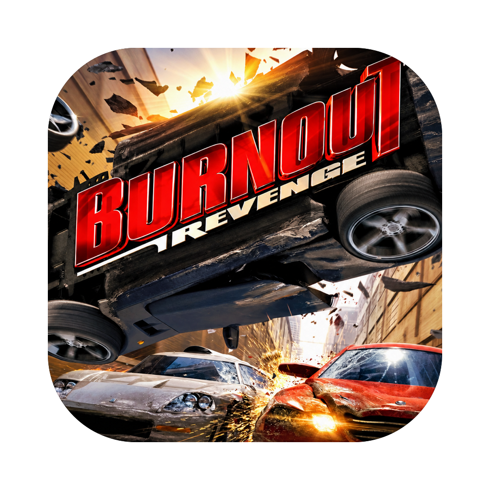

<h1 align="center">Burnout Revenge for Mac</h1>

  An unofficial native port of <i>Burnout Revenge</i> (Xbox 360, USA) for Apple silicon Macs. 
  The game's PowerPC code is recompiled ahead of time into an arm64 program; graphics run on Metal through Vulkan/MoltenVK. 
  You bring the game from your own disc.

  <a href="https://github.com/secretpray/burnout-revenge/releases/latest"><b>Download</b></a>
  &nbsp;·&nbsp;
  <a href="#quick-start">Quick start</a>
  &nbsp;·&nbsp;
  <a href="#highlights">Highlights</a>
  &nbsp;·&nbsp;
  <a href="#rewind">Rewind</a>
  &nbsp;·&nbsp;
  <a href="#mods">Mods</a>
  &nbsp;·&nbsp;
  <a href="#languages">Languages</a>
  &nbsp;·&nbsp;
  <a href="#settings">Settings</a>
  &nbsp;·&nbsp;
  <a href="CHANGELOG.md">Changelog</a>
  &nbsp;·&nbsp;
  <a href="docs/BUILD.md">Build</a>

> [!IMPORTANT]
> This is a non-commercial fan project, not affiliated with or endorsed by
> Electronic Arts, Criterion Games, Microsoft, Sony or Apple. No game data is
> included or distributed: no disc image, extracted files, add-on packs, music
> or generated PPC sources. You need your own USA Xbox 360 disc image. Please do
> not ask for game files or attach them to issues.

  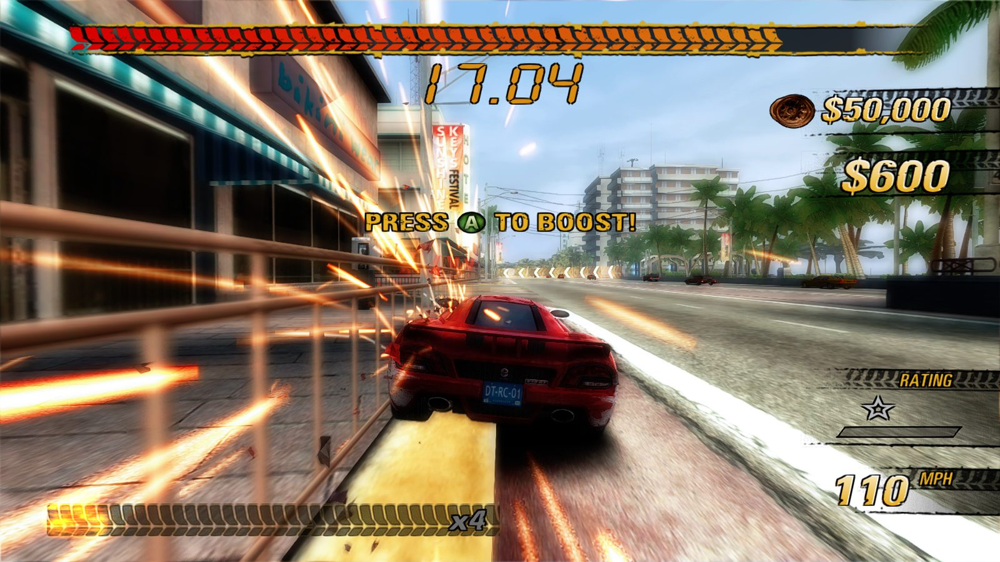

<table>
  <tr>
    <td width="50%">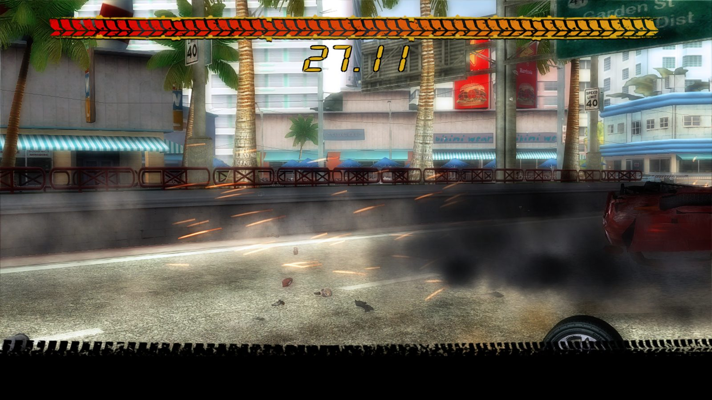 The crash camera.</td>
    <td width="50%">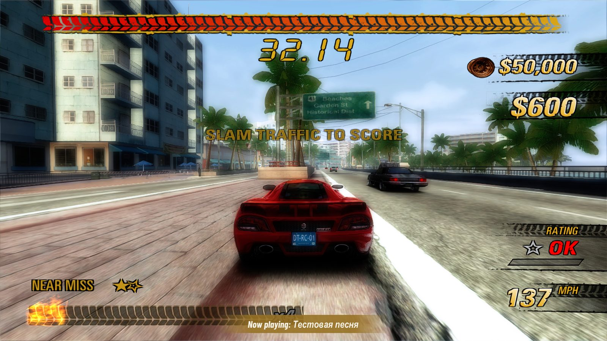 A near miss, with your own music playing.</td>
  </tr>
  <tr>
    <td width="50%">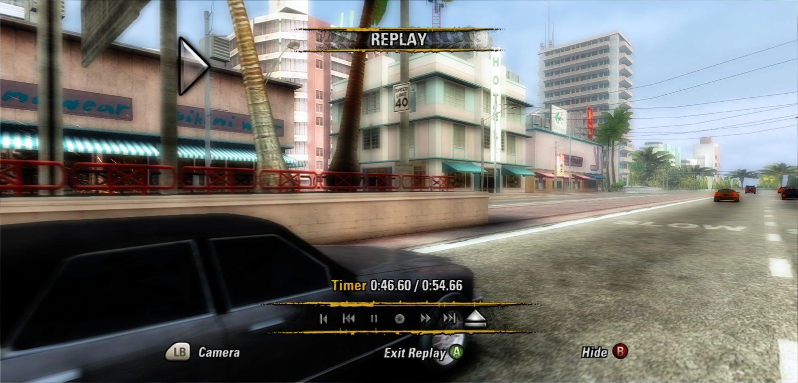 Replay after a race, in a wider-than-16:9 window.</td>
    <td width="50%">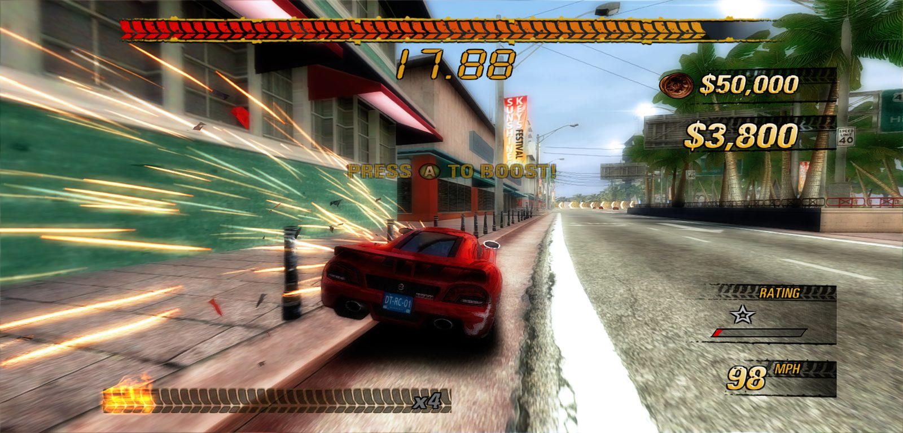 Wide windows show more of the road (Hor+).</td>
  </tr>
  <tr>
    <td width="50%">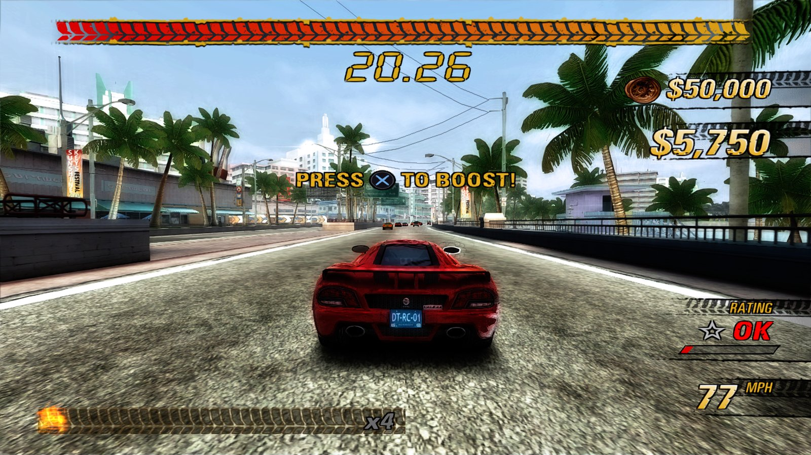 Bloom off, the sky kept; the game's prompts for a DualSense.</td>
    <td width="50%">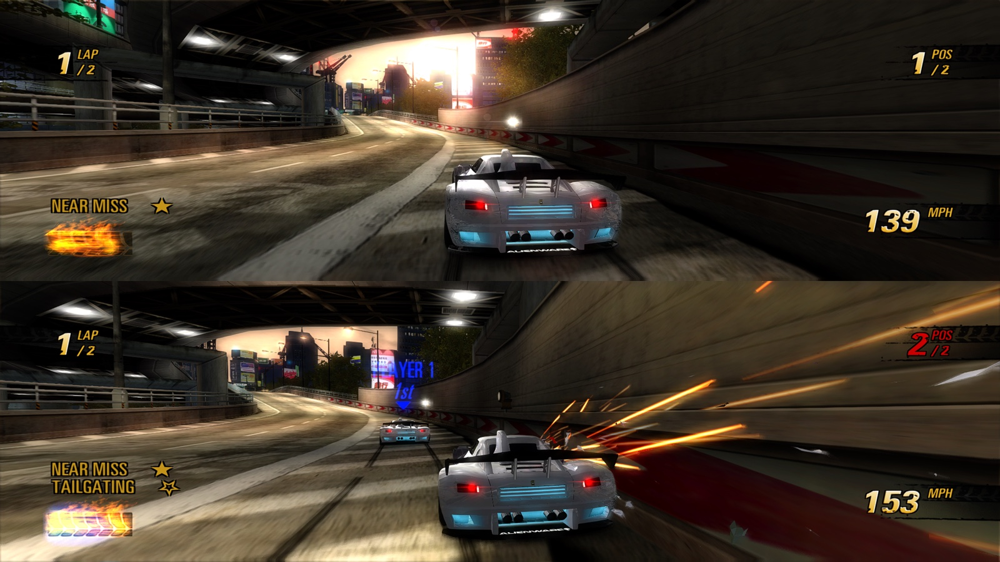 Split screen for two, a controller each.</td>
  </tr>
</table>

Unedited screenshots from this port on an M1 Pro. The game content in them belongs to its owners.

> [!TIP]
> **New in v0.1.25:** Classic Crash Launch in network play, changes applied on Retry, solo Codes and Rewind with Live sign-in enabled, and Madden Van unlock in a clearer Mods page. Controller slots stay stable after disconnects; My Music indexes in the background and resumes after reward videos. [Release notes](https://github.com/secretpray/burnout-revenge/releases/tag/v0.1.25).

**TL;DR**

- The original 2006 Xbox 360 game runs as a native Mac app: its own cars, tracks,
  physics, menus, EA Trax and saves. Nothing is remastered; the extras are
  options on top.
- Compared with the console: up to 4K internal resolution, SMAA or FXAA,
  FSR 1 or MetalFX upscaling, 16x anisotropic filtering, any window shape,
  your own music instead of EA Trax, keyboard play and save backups.
- [Download](https://github.com/secretpray/burnout-revenge/releases/latest) the DMG, drag the app to
  Applications, open it and choose your disc image. It checks and installs the
  game, then you play.
- Optional [Rewind](#rewind) for solo World Tour, and [Codes](#mods) for the solo career, and Xbox Live
  play again through community or your own servers.
- Menus and game text in **English, Japanese, German, French, Spanish, Italian, Dutch, Swedish and Finnish**.
  [Language setup](#languages) explains the optional European disc import.
- Updates install over the old version. Saves and settings stay.
- Settings: **F1**, **Cmd+,** or **Back + Start** on a controller.

## Highlights

**Gameplay and mods**

- **Classic Crash Launch**: the PS2 and original Xbox meter in solo World Tour
  and network Crash. Set speed and control with separate taps. Switch it in
  Settings > Mods > Modifications, then retry or start another event; no app
  restart is needed. Each network player can choose their launch style.
- **Rewind 10, 20 or 30 seconds** in six solo World Tour event types, with
  configurable controller combinations and keyboard shortcuts.
- **Cheat Codes**: five optional solo driving modifiers and **Unlock Madden Van**.
  The van uses the original trailer reward and does not require 100% completion.
  Save your Player File after unlocking it, then choose it in a Crash garage.
- Live sign-in does not disable solo Codes, Rewind or camera controls. Their
  restrictions follow the active network or local multiplayer session.

**Picture**

- Internal resolution from 1x (720p, as on the console) to 3x (2160p). Auto
  picks it from the size of the window.
- SMAA 1x (default) or FXAA anti-aliasing. SMAA keeps text, number plates and
  textures sharper for about 0.4 ms more GPU time at 1080p.
- Upscaling with Bicubic, Bilinear, AMD FSR 1 or Apple MetalFX Spatial
  (experimental), with adjustable sharpening.
- Up to 16x anisotropic filtering, mipmaps, a brightness control and the Xbox
  360's own display gamma ramp.
- Any window shape: a wider window shows more at the sides (Hor+), a taller one
  (16:10, 4:3) more above and below (Vert+), with the HUD kept in shape. On
  either (21:9, 32:9, 16:10, 4:3) the race HUD sits at the screen's corners and
  the menus' frame at its edges; menus and films stay 16:9 in the middle.
  Widescreen keeps the original 16:9 with bars.
- Vehicle Detail: rivals and traffic keep their detailed models twice as far
  away by default (Far), or four times (Farthest), so cars ahead stop
  changing shape as you close in. Original is the console's 30 m.
- Bloom and Motion Blur from 0 to 100%. Lower Bloom removes the game's haze
  and the glow round edges but keeps its bright blue sky: the glow is kept where
  it comes from rather than switched off. Lower Motion Blur shortens the streaks
  at speed; 0% keeps speed sharp.
- The game's own menu clicks in the Settings menu and the first-run screens,
  read from your copy of the game.
- 60 fps, as the console. Fullscreen, V-Sync, and Cmd+H and Cmd+Tab that work
  in fullscreen. On an external 144 or 165 Hz monitor, a one-time note says how
  to set it to a rate 60 fps divides evenly.

**Sound and music**

- The game's own engines, crashes and EA Trax, decoded from your disc.
- **My Music**: Settings > Audio > Music plays your own MP3, AAC, ALAC, FLAC,
  WAV or AIFF files instead of EA Trax, shuffled, with a "Now playing" notice
  naming each song. The game's pauses, fades and crash silence apply to them.
  The folder is indexed in the background and refreshed about every two seconds
  after each scan. EA Trax plays while the first list loads. One scan is limited
  to 4,096 songs and 16,384 entries; the Music Folder row indicates the limit or
  an unavailable folder.
- The game's sound steps back while the settings menu is open. Mute, Mute in
  Background and a master volume.

**Online**

- Xbox Live play again, off by default (Settings > Online): races, Road Rage,
  Crash Party, Crash Tour and Crash Battle with up to four players, and
  Burnout Clips shared, watched and downloaded. Meet on the Xerenge community
  server, a server of your own (it comes inside the app) or the local network
  with no server. Ranked matches can be hosted and joined too, without a
  global ranking or TrueSkill service. Not yet tested between two Macs: see
  [docs/ONLINE.md](docs/ONLINE.md). Xbox Live friends, messages, player reviews
  and gamer cards are unavailable; their buttons leave the game running.

**Controls**

- Xbox controllers and DualSense through SDL, with vibration. Back + Start
  (Share + Options on a DualSense) opens the settings anywhere. If an Xbox
  controller uses Apple's GameController route over USB, a one-time notice
  explains that vibration may not reach its motors and suggests Bluetooth.
- Split-screen Multiplayer for two: each controller is a player, in the
  order it connects. During a local session, a disconnection preserves the
  other player's slot and pauses the game. Reconnect a controller, then press
  Start on it to join the first missing player shown in the notice. Release
  all controls before resuming. A spare controller cannot take a slot silently.
  Solo keeps the remaining controller as player 1. Two physical controllers
  still need testing.
- USB steering wheels (Logitech G29 and its family): wheel, pedals, buttons
  and Settings > Wheel with a Calibrate row; force feedback where the
  system can drive the wheel.
- Full keyboard play. Every Xbox 360 control can take two keys, remapped in
  the Controls page; bindings are physical keys, so they work on any layout.
- Button prompts follow the device you use, in the port's menus and in the
  game's own (menus, Replay, "PRESS TO BOOST!"): PlayStation shapes with a
  DualSense, your keys as Mac key caps with the keyboard, Xbox buttons
  otherwise. Settings > Input > Button Prompts can keep one set.

**A menu in the game's own style**

- A settings menu modelled on the game's Settings screen: its fonts, its
  orange rows and yellow bands, its running chevrons and button hints. Each row
  explains itself; most changes apply live, while Language needs a restart.
- Dialogs, notices and the "What's new" note look like the game's own prompts.

**Achievements**

- Settings > Achievements lists the 36 original Xbox 360 achievements (1000 G),
  with grey locked icons, color earned icons and requirements for the selected
  entry. New awards appear during play and are kept across launches.
- Local progress, using the game's own award requests and artwork from your
  disc. See [Achievements](docs/ACHIEVEMENTS.md) for account and import details.

**Setup and saves**

- A first-run setup in the game's style: choose your ISO, and all 802 files are
  checked against the supported release before anything is installed. EA Trax
  from your own disc plays while it installs. Cancelled, failed or cut short
  by a crash, an install leaves nothing behind: no partial copy, no empty
  folders.
- Add-on car packs: choose a folder at setup, import later from Settings, or
  let the game find `XBOX360/454107DC/00000002` on a mounted drive.
- Saves can't be half-written: a save is written to a copy and put in
  place whole once the game finishes it, so a crash or power cut mid-save
  leaves the previous save.
- Save backups: each launch backs up your saves when they changed (the newest
  10 are kept). Settings > Advanced > Save Backups restores one.
- Save import: Save Backups > Import Save File / Import Save Folder (or
  `--import-save <path>` with the game closed) brings in a save from an Xbox 360
  (its save package, e.g. `Content/<profile>/454107DC/00000001/` on a USB stick),
  from Xenia's content folder, or the game's `Player Files`. Your current saves
  are backed up first; the import applies at the next launch.
- A finished save (Elite rank, every event and all 86 cars) comes with each
  release from v0.1.10 as `BurnoutRevenge-100-percent-save.zip`: unzip it and
  import its `Player Files` as above. It's a save shared online for the USA
  game; only its progress file is included, without the original profile.
- Skip Intro Movies (on by default): the title screen in about 8 seconds.
- Save Bug Report gathers the logs and settings into one file; Check for
  Updates asks GitHub for a newer release.

## Rewind

Enable **Settings > Rewind** to keep driving history in memory, then rewind
without opening the menu. This experimental option is **off by default** and
available in **solo World Tour Race, Road Rage, Traffic Attack, Burning Lap,
Eliminator and Crash**.

| Rewind | Keyboard | PlayStation | Xbox |
|---|---|---|---|
| 10 seconds | F2 | L1 + R1 | LB + RB |
| 20 seconds | F3 | L3 + R3 | LS + RS |
| 30 seconds | F4 | L1 + R3 | LB + RS |

Each duration has its own editable controller combination and two keyboard
bindings. Select a controller row, release the buttons, then hold and release
two or three buttons to assign them. During play, hold the combination for
**0.3 seconds** and release it fully before another request. Conflicting
combinations are rejected. L2/R2 (gas and brake) are excluded.

  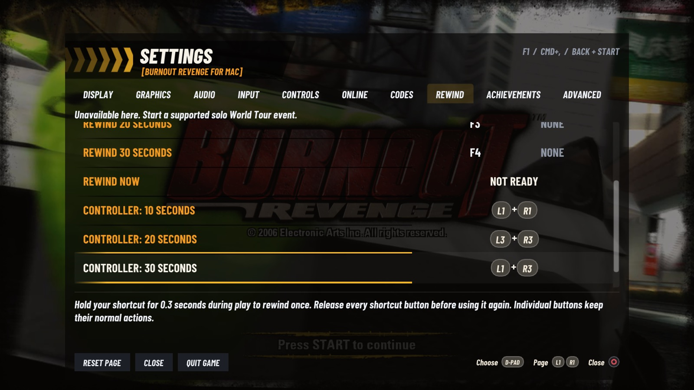
   
  Assign a separate controller combination to each rewind duration.

  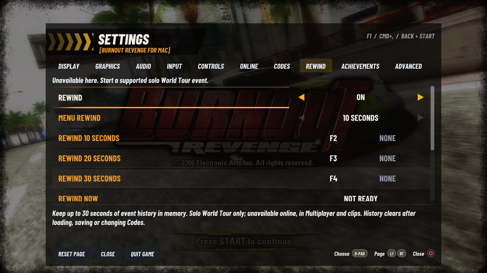
   
  Keyboard shortcuts are configurable too; Menu Rewind has its own duration.

A notice appears when a request starts, then shows **the actual time restored**
or the reason it could not be applied. In road events, targets inside a wreck/
Aftertouch use the preceding driving checkpoint; requests made during that
crash camera wait until driving resumes. This can rewind farther than the selected duration.

  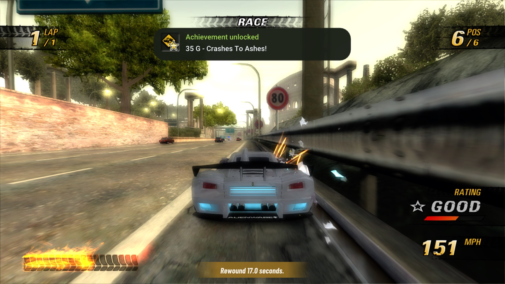
   
  Aftertouch request completed: the notice reports the actual 17.0-second rewind.

History starts collecting five seconds into road events and one second into
Crash, and holds up to 30 seconds. Wait for enough history before using a shortcut. Saving, loading, event changes
and changes to Codes clear it. Online, local Multiplayer, clips and finished
events are excluded. Single buttons retain their game actions before a complete
combination is held, so choose combinations that suit your controls.
[Details, validation and limits](docs/REWIND_EXPERIMENT.md).

## Mods

  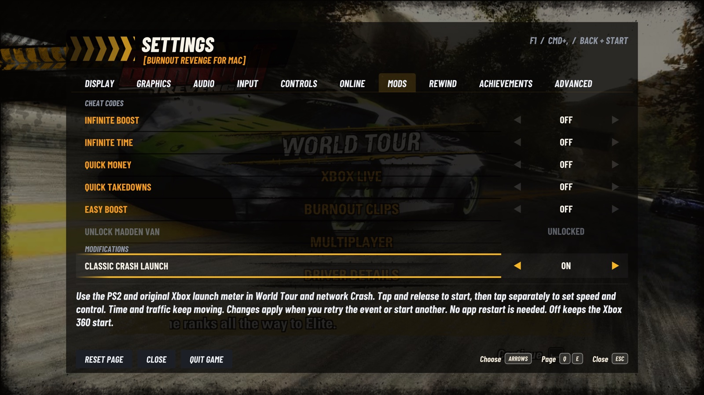
   
  Settings > Mods: Cheat Codes and Modifications.

Classic Crash Launch restores the PS2 and original Xbox launch meter
in solo World Tour and network Crash. It is off by default. A change applies when
you retry the event or leave it and start another, without quitting the app.
Each network player chooses whether to enable it.
Tap and release A (PlayStation cross) to start the meter, then use separate
presses to set speed and control. Holding the first press can stop it at about
one third and give a weak automatic launch, as in the original PS2/Xbox game.
[Controls and current limits](docs/CLASSIC_CRASH_LAUNCH.md).

**Cheat Codes > Unlock Madden Van** opens the same bonus as the Madden NFL 06
trailer. It is available with your Player File loaded in the World Tour menu;
100% completion is not required. Save your Player File afterwards to keep it,
then select the van in a Crash event’s garage.

<table>
  <tr>
    <td width="50%">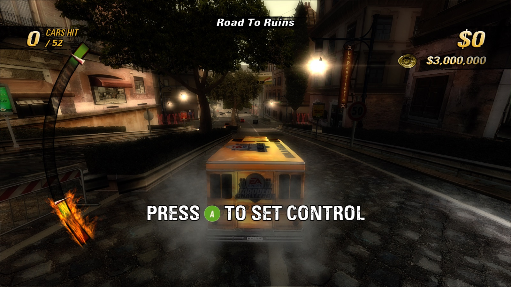 Set speed, then control.</td>
    <td width="50%">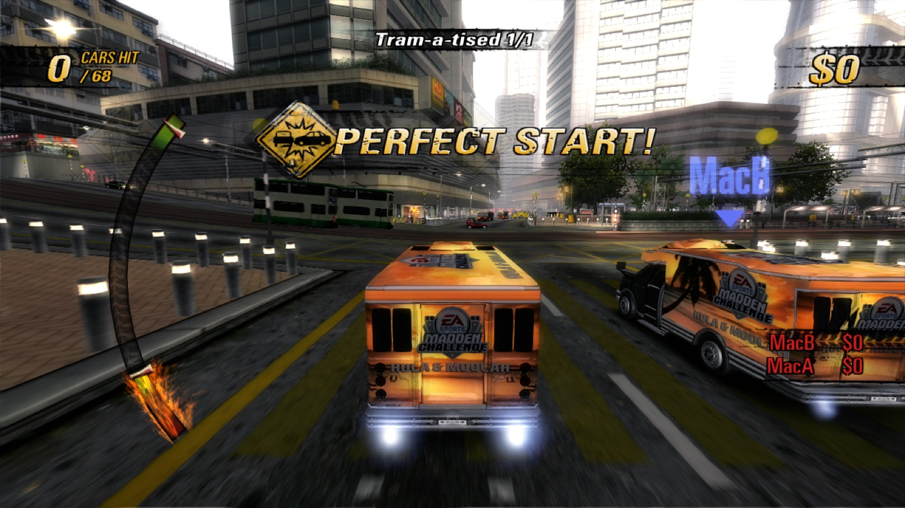 Classic launch in network Crash.</td>
  </tr>
</table>

Five modifiers for the **solo World Tour**, modelled on the old Xbox 360 trainers.
They change what the game awards, not how it saves: results earned with a Code stay
in your career.

| Code | What it does |
|---|---|
| **Infinite Boost** | The boost bar stays full at level 4. Turn it off and your earlier level comes back |
| **Infinite Time** | The event countdown stops; the game's own time bonuses still apply. Turn it off to finish an event that ends on timeout |
| **Quick Money** | Every Traffic Attack award is at least $30,000 |
| **Quick Takedowns** | After your first real Takedown the event counts 99, and the HUD, medal and results agree |
| **Easy Boost** | A Near Miss fills the current bar, and Near Miss and drift need less speed and distance |

  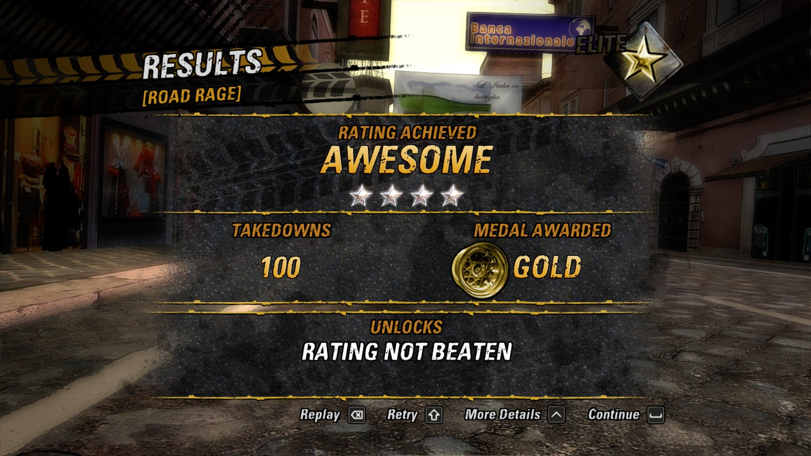
   
  Road Rage with Quick Takedowns: 100 Takedowns, a Gold medal.

The five driving modifiers apply only to solo World Tour driving. Signing in
to Live or enabling Online Play does not restrict solo play. Local Multiplayer, Crash, Burnout Clips and AI cars retain their
original behavior. The Madden Van action and Classic Crash Launch have their own
scope as described above.
Details and limits: [docs/CODES.md](docs/CODES.md).

## Xbox 360 achievements

The original **36 achievements, worth 1,000 G**, now unlock through normal play.
Open **Settings > Achievements** to browse them: locked icons are grey, earned
icons are in full colour, and the bottom of the page shows the selected
achievement's conditions and unlock date. The wider settings menu gives the tabs
more room, with scrolling on smaller windows.

  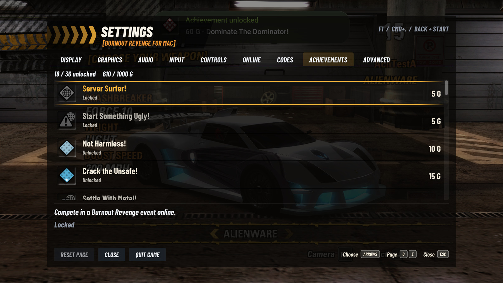
   
  Settings > Achievements: original icons, conditions and local Gamerscore.

An unlock displays a six-second notification during the game without pausing it
or taking control away. Achievements and their unlock dates are saved locally
between launches; repeated game requests do not repeat the notification. Names,
conditions and artwork come from your own game disc. They do not sync with an
Xbox Live, Steam or RetroAchievements account.

  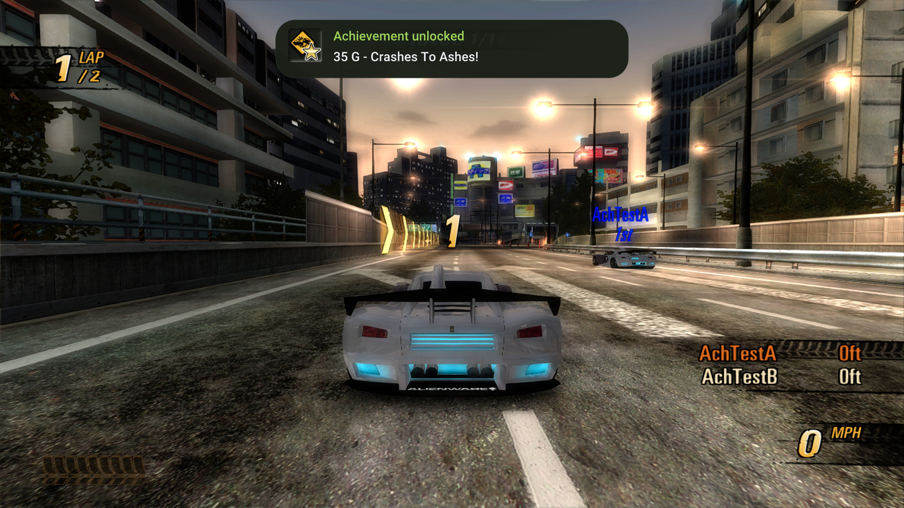
   
  Crashes To Ashes: the six-second achievement notification during online play.

## Quick start

1. Download **BurnoutRevenge-x.y.z-macos.dmg** from
   [Releases](https://github.com/secretpray/burnout-revenge/releases/latest) and drag
   **Burnout Revenge.app** to Applications.
2. Open it. The app is signed ad hoc, not notarized: if macOS blocks it, use
   System Settings > Privacy & Security > Open Anyway.
3. Choose your language and your **USA Xbox 360 disc image** (.iso). Optionally choose an install
   folder and your add-on car packs, then Install & Verify.
4. Start your engines. Later launches go straight to the game. For translated game
   text, [import language resources](#languages) from your own European disc image.

  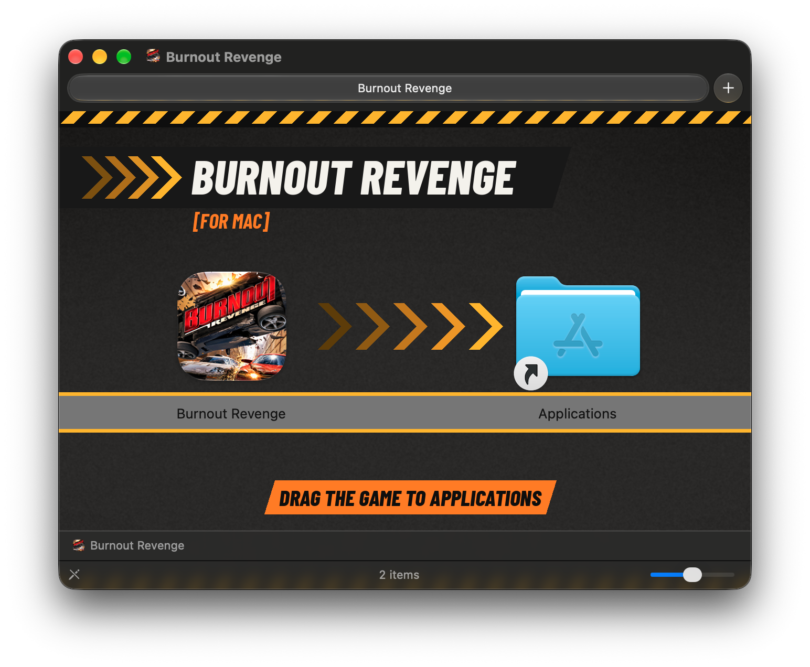
   
  The download: drag the game to Applications.

<table>
  <tr>
    <td width="25%">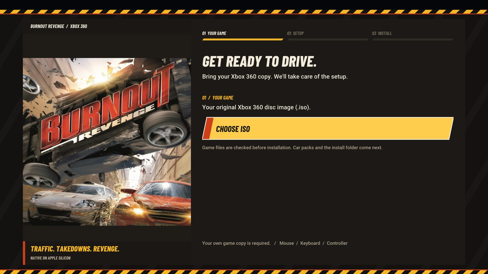 1. Your game.</td>
    <td width="25%">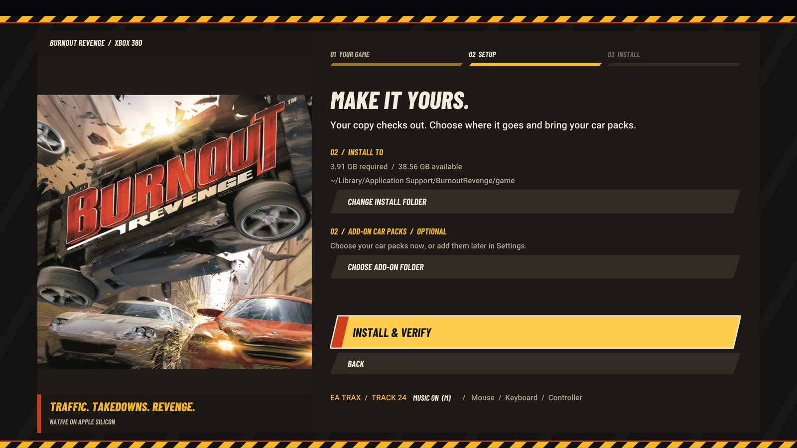 2. Setup.</td>
    <td width="25%">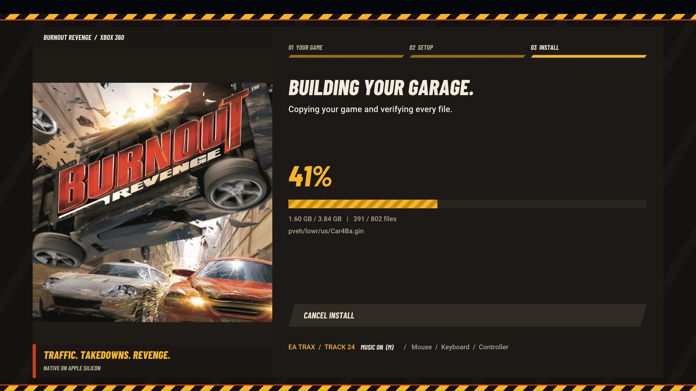 3. Install, every file verified.</td>
    <td width="25%">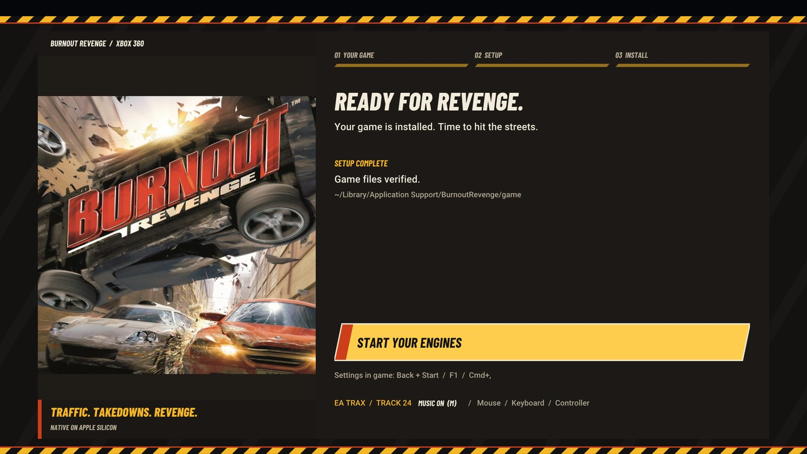 Ready.</td>
  </tr>
</table>

Settings, saves and the installed game live in
`~/Library/Application Support/BurnoutRevenge`; shader caches in
`~/Library/Caches/BurnoutRevenge`.

**Requirements:** an Apple silicon Mac with macOS 15 or later, and the USA
Xbox 360 disc image of Burnout Revenge. Developed and tested on an M1 Pro.
European disc images can supply [language resources](#languages); game installation
still requires the USA revision. European or Japanese executables, title updates
and GOD packages are not supported. [Xbox 360 saves can be imported](#highlights).

## Settings

Open with **F1**, **Cmd+,** or **Back + Start**. LB/RB (Q/E) switch pages.

<table>
  <tr>
    <td width="50%">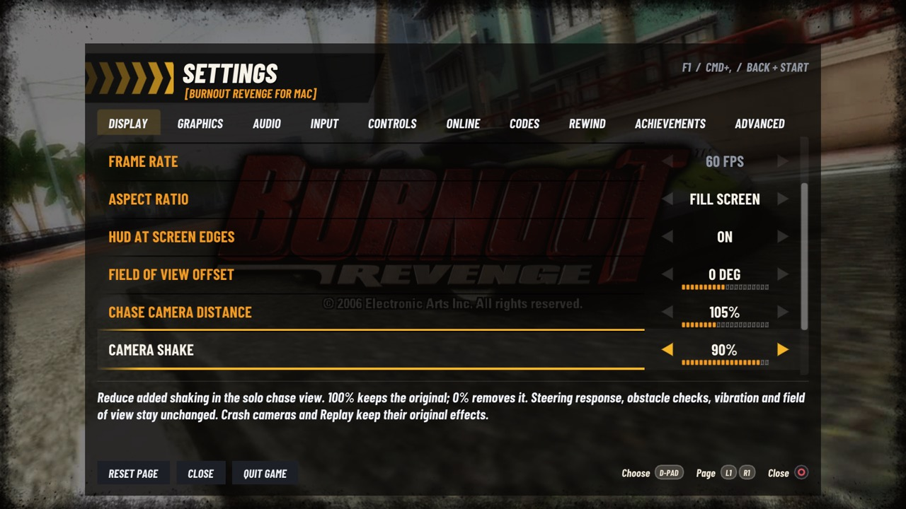 Display: FOV, camera distance and shake.</td>
    <td width="50%">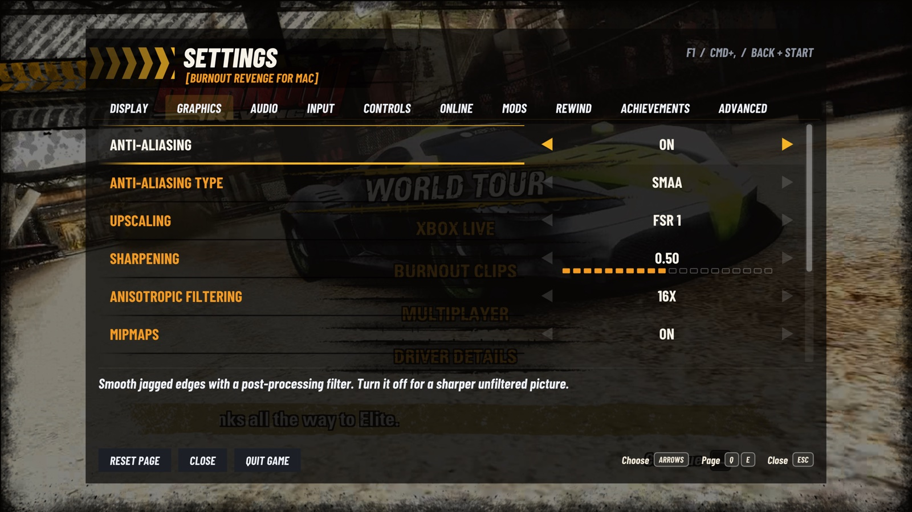 Graphics: anti-aliasing and upscaling.</td>
  </tr>
  <tr>
    <td width="50%">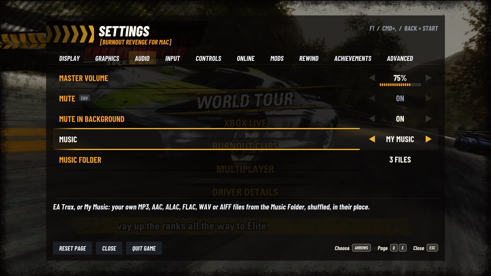 Audio: volume and music.</td>
    <td width="50%">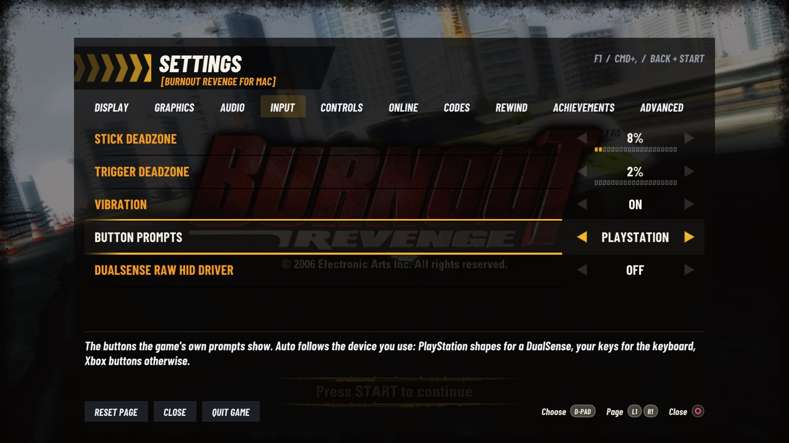 Input: deadzones, vibration and button prompts.</td>
  </tr>
  <tr>
    <td width="50%"> Mods: Cheat Codes and Modifications.</td>
    <td width="50%">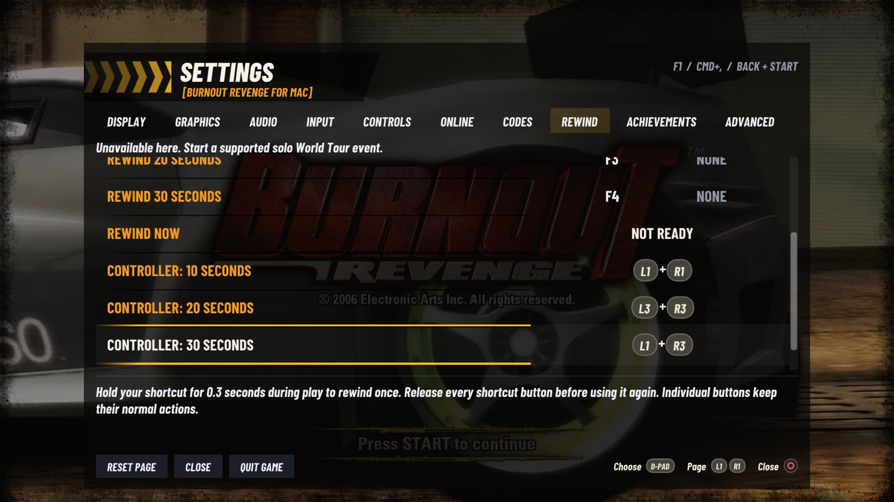 Rewind: configurable 10/20/30-second shortcuts.</td>
  </tr>
</table>

| Page | What's there |
|---|---|
| Display | Fullscreen, V-Sync, Frame Rate, Aspect Ratio (fill any window, or 16:9), HUD at Screen Edges (not 16:9), Field of View Offset, Chase Camera Distance and Camera Shake, Brightness, Xbox 360 Display Gamma |
| Graphics | Anti-Aliasing and its type (SMAA, FXAA), Upscaling (Bicubic, Bilinear, FSR 1, MetalFX Spatial), Sharpening, Anisotropic Filtering, Mipmaps, Internal Resolution, Bloom, Motion Blur, Vehicle Detail |
| Audio | Master Volume, Mute, Mute in Background, Music (EA Trax or My Music), Music Folder |
| Input | Stick and trigger deadzones, Vibration, Button Prompts (Auto, Xbox, PlayStation, Keyboard), DualSense raw HID driver |
| Wheel | Shown while a steering wheel is plugged in: Steering Wheel, Steering Range, Invert Steering, Steering Deadzone, Steering Response, Force Feedback, Centering Force, Calibrate |
| Controls | Two keys for each Xbox 360 control |
| Online | Online Play, Server (Xerenge Community, My Server, LAN), Gamertag, Server Address, Check Server ([online play](docs/ONLINE.md)) |
| Achievements | Original Xbox 360 list, requirements, earned dates and local Gamerscore ([details](docs/ACHIEVEMENTS.md)) |
| Mods | Cheat Codes: five solo driving modifiers and Unlock Madden Van. Modifications: Classic Crash Launch ([details](#mods)) |
| Rewind | 10/20/30-second history, editable keyboard and controller shortcuts; [controls and current limits](docs/REWIND_EXPERIMENT.md#working-controls) |
| Advanced | Language, Import Languages from Disc, Asynchronous Shaders, Performance Overlay, Auto-import Add-ons, Skip Intro Movies, Save Bug Report, Check for Updates, Add-ons, Save Backups, About |

**Display > Field of View Offset** widens or narrows
ordinary solo World Tour driving by -20 to +20 degrees, applied live. 0 keeps
the original; speed and boost still change the view. Crash/Aftertouch cameras,
Replay, mirrors, menus and multiplayer retain their native view.

**Chase Camera Distance** on the same page changes the distance behind the car
from 75% to 150%, with 100% as the original. It applies during ordinary solo
World Tour chase-camera driving, retaining the game's obstacle checks. A change
made while paused takes effect when play resumes; other camera modes keep their
native position.

These camera controls also work in solo World Tour while signed in to Xbox Live.
The distance control does not select the camera view: the game's Y button
(Triangle with PlayStation hints, Left Ctrl on the default keyboard mapping)
switches between the bumper view and the chase view behind the car.

**Camera Shake** reduces the native added position and rotation effects in the
solo World Tour chase view: 100% keeps the original, 0% removes them. It leaves
steering response, obstacle checks, controller vibration and native FOV effects
intact. Crash/Aftertouch cameras, Replay and other camera modes retain their
original effects. The setting applies when play resumes, with no extra smoothing
or input delay.

A good start on an M1 Pro: 1.5x internal resolution (1080p), SMAA, Bicubic,
sharpening 0.3 and 16x anisotropic filtering. Use 1x if the GPU can't keep
60 fps.

  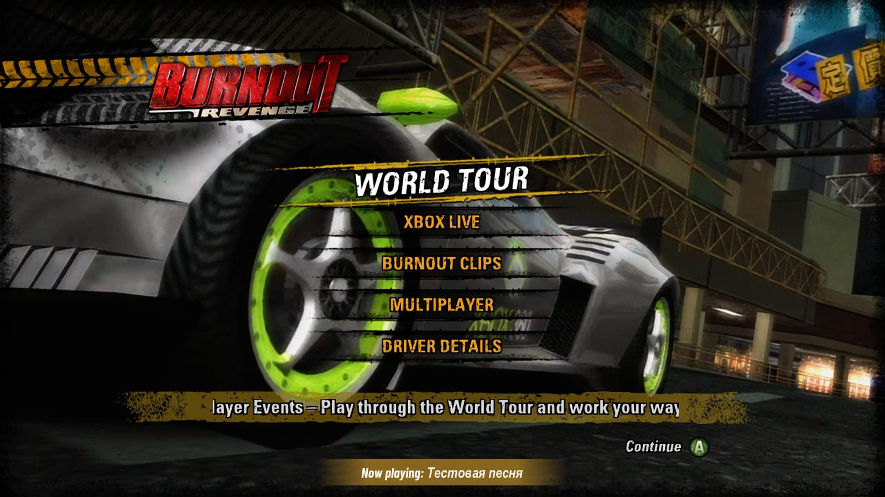
   
  My Music in the main menu. Song names in any script are shown.

### Languages

  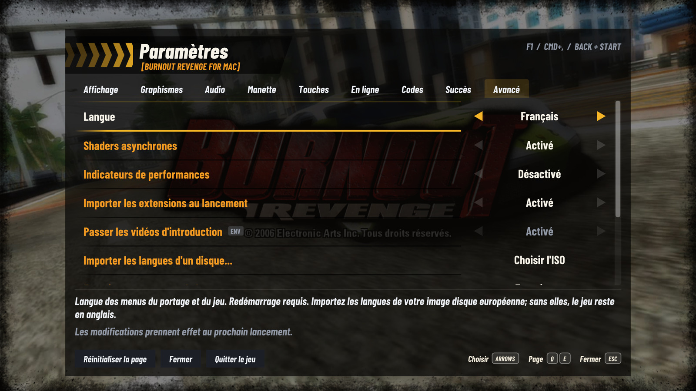
   
  French settings: the language choice and verified disc import.

The port menus, setup, dialogs, settings help, Codes and achievement status
are available in **English, 日本語, Deutsch, Français, Español, Italiano,
Nederlands, Svenska and Suomi**. All nine also have verified original game text.

Choose a language in the first-run screen, or in
**Settings > Advanced > Language**. A change in Settings applies
after restarting the game. If `BURNOUT_LANGUAGE` is set, the menu shows that
active language with an ENV marker and disables editing; remove the variable
to use the saved choice.

The USA disc contains English game text. To use another game language, choose
**Import Languages from Disc...** in Advanced and select your own European Xbox
360 ISO. The **Europe (Fr,De,It)** disc contains the Japanese, German, French,
Spanish and Italian text resources. Both European editions also supply Dutch,
Swedish and Finnish; **Europe (En,Es,Nl,Sv,Fi)**
also supplies Spanish. These are the disc editions tested with this port, identified directly
from each disc's `default.xex` execution info:

| Xbox 360 edition | Title ID | Media ID | XEX version | Use in this port |
|---|---|---|---|---|
| USA | `454107DC` | `223759FA` | `0.0.0.4` | Required base game; English text |
| Europe (Fr,De,It) | `454107DC` | `213B2D4C` | `0.0.0.1` | Import Japanese, German, French, Spanish and Italian, Dutch, Swedish and Finnish |
| Europe (En,Es,Nl,Sv,Fi) | `454107DC` | `29FD0247` | `0.0.0.7` | Import Spanish, Dutch, Swedish and Finnish text |

Use the **USA base game** above, then import from **Europe (Fr,De,It),
Media ID `213B2D4C`**, for all eight additional game languages.
All three editions share the same Title ID; use the Media ID to distinguish them.
The importer checks the original executable's SHA-256 hash and the language
files' paths, sizes and SHA-256 hashes, so a
matching Title ID or renamed ISO alone does not establish compatibility.
Dutch, Swedish and Finnish use the existing Language choice and import action;
no additional settings page is needed.

To apply a game translation:

1. Open **Settings > Advanced > Import Languages from Disc...**.
2. Select your own European Xbox 360 ISO and wait for the import confirmation.
3. Choose **Language** above, then close and restart the game.

Importing copies only verified language files into the game's data folder,
without replacing the USA executable or your saves.
Missing or damaged resources leave the game in English, with an explanation;
the port's menus still use the language you chose.

  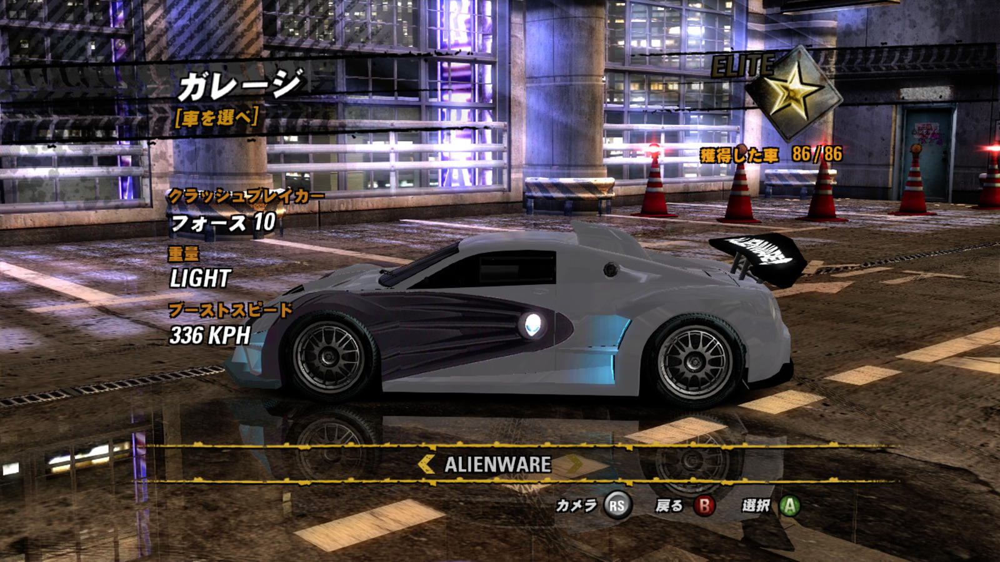
   
  The original Japanese game text and font, loaded alongside the USA game.

  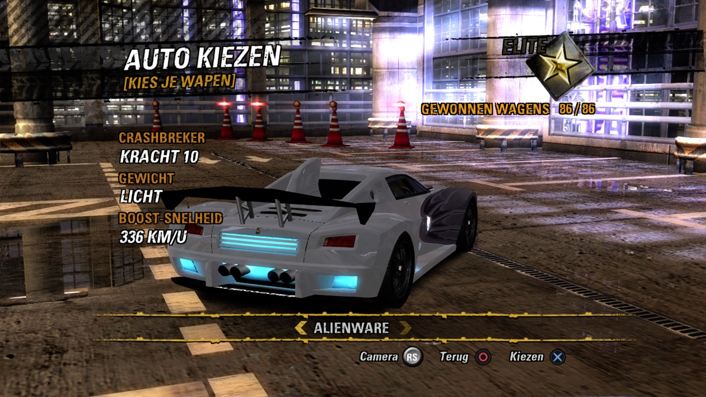
  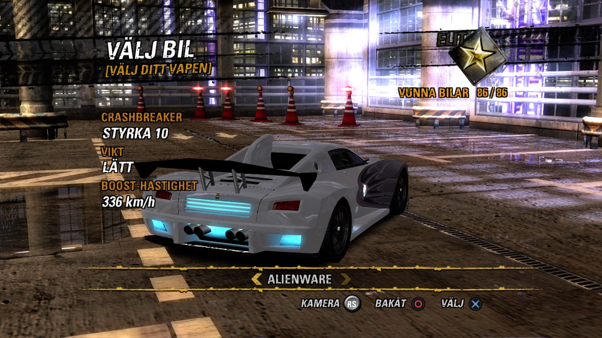
  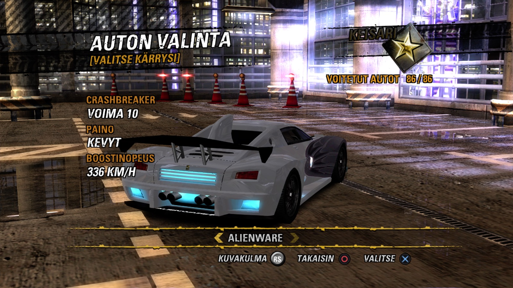
   Nederlands · Svenska · Suomi — original disc text with the USA executable.

Japanese uses the original disc font in the game and system glyphs in the port
menus. Achievement names and requirements use the original translations from
your game; the Japanese edition's achievement names remain in English. The
original achievement database has no Dutch, Swedish or Finnish text, so their
achievement names and requirements use English while the port's status text is
translated. Movie
audio, music titles and the original title artwork are unchanged;
release notes and technical diagnostics may remain in English. The recompiled
executable still targets the USA revision; importing languages does not add
support for running a European executable.

### Keyboard

| Action | Keys |
|---|---|
| Accelerate / brake | W / S (right / left trigger) |
| Steer | A / D or the arrows |
| Boost (A) | Space |
| B / X / Y | Backspace / Left Shift / Left Control |
| Shoulders (LB / RB) | Q / E |
| Start | Return |

Every key can be changed in Settings > Controls.

## Known limits

- Tested on one M1 Pro with its own controllers; other Macs and accessories
  may behave differently. USB is the fallback for a Bluetooth pad.
- Steering wheels are tested on a virtual Logitech G29 only, not yet on a
  real wheel; reports are welcome. Split screen for two is tested with two
  virtual controllers (Multiplayer Race), not yet with two real ones.
- A complete career playthrough isn't verified yet.
- Online play (Settings > Online, off by default) is tested with up to four
  copies on one Mac and over the community server, not yet between Macs on
  different networks. Global rankings, TrueSkill and Scoreboards are unavailable.
  See [docs/ONLINE.md](docs/ONLINE.md).
- Some uncommon console services and exception-handling paths are unsupported.
  Xbox Live friends, reputation and gamer-picture services are unavailable.
- Live frame generation is not enabled.

More detail: [rendering notes](docs/RENDERING.md), [picture settings](docs/IMAGE_QUALITY.md).

## Origins and license

Built on [SpeedBreaker](https://github.com/SpeedBreakerProject/speedbreaker)
(its v0.1.6 runtime, with v0.1.7's refresh-rate note) and the Burnout research in
[Xbox360-Native-Ports](https://github.com/CrownParkComputing/Xbox360-Native-Ports/releases/tag/burnoutrevenge-v1).
It also relies on XenonRecomp, Xenia research, SDL, MoltenVK, FFmpeg, AMD
FidelityFX, SMAA, Dear ImGui and the Barlow Condensed fonts; see
[CREDITS.md](CREDITS.md) and [THIRD_PARTY_NOTICES.md](THIRD_PARTY_NOTICES.md).
Much of what this port knows about the game comes from
[Xerenge](https://github.com/shipa-2/Xerenge) by shipa-2 (the ReXGlue-based
Burnout Revenge port); ideas also come from
[Takedawn](https://github.com/xenophobentx/takedawn) (Burnout 3) and
[Fukami](https://github.com/danisandoval/fukami) (Ridge Racer V). Their code
isn't copied; what came from each is in [CREDITS.md](CREDITS.md).

The runtime and its changes are **GPL-3.0-or-later**; original authors'
notices and third-party licenses are kept. See [COPYING](COPYING) and
[NOTICE](NOTICE). Each release ships the exact sources of its statically linked
LGPL libraries. The cover art and the Burnout name belong to their owners and
aren't covered by the code license. The software comes with no warranty.
