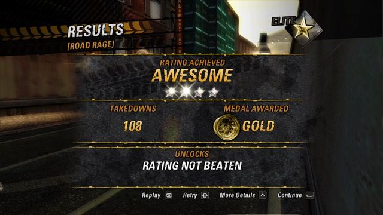
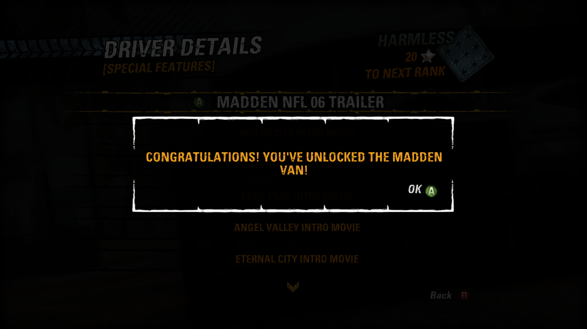

# Codes: offline cheats for the solo career

Open Settings (F1, Cmd+, or Back + Start) and go to **Codes**. There are five
modifiers, in the spirit of the Xbox 360 trainers by RETROBYTE (Aurora) and
TeamXPG. All are off by default and apply at once, without a restart. They
work only in solo World Tour driving events. Career progress is saved through
the game's normal path, so a result earned with a Code stays in your career. Our
code never edits your save file.

| Code | What it does | Checked in the game |
| --- | --- | --- |
| Infinite Boost | The player's boost bar is full at level 4 (720 in a Race); turning it off restores the earlier level | Race and Road Rage: level 4, 720/720 while A is held; AI cars are unaffected |
| Infinite Time | The event timer does not run down; the game's own time bonuses still apply. Turning it off resumes from the frozen value | Road Rage: ~60 s held through 50+ s of driving; turned off from the menu mid-event, the countdown continued from the same value and the event finished normally |
| Quick Money | Every Traffic Attack award is at least $30,000 | Traffic Attack: a 3,000 Traffic Check paid 30,000; the HUD reached $2,220,000 against a $1,250,000 gold target |
| Quick Takedowns | After your first real Takedown the event counts 99; later Takedowns add normally | Road Rage results: **108 Takedowns, GOLD, AWESOME** |
| Easy Boost | A Near Miss fills the current boost bar; Near Miss and drift need less speed and distance | Race: the bar went from 0/240 to 240/240 on the first Near Miss |

## Limits

- Online Play must be off **at launch**. If it is on, turn it off and restart:
  even a solo race in that process gets no Code.
- Local Multiplayer, turn-based Crash, Burnout Clips and AI cars are excluded.
  Boost use and the Crashbreaker are unchanged in Crash.
- The guard sits in the game hook itself, so the menu switch and the
  `BURNOUT_INFINITE_BOOST`-style environment variables cannot bypass it. An
  unknown session is rejected.
- With Infinite Time on, an event that ends on timeout will not end. Turn it
  off to finish. (The RETROBYTE trainer carries the same warning.)
- Quick Money and Quick Takedowns change the event result and medal stored in
  your career.
- Not provided: arbitrary memory writes, an external code manager and
  Unlock All.

## How they map to the RETROBYTE trainer

The trainer's addresses (`0x8236BF34` timer, `0x82324E00` money, `0x8276FC2C`
takedowns, `0x82CE34F0` boost) belong to a different build of the executable:
in the USA XEX this port runs they are other instructions. Nothing was copied
from the trainer's binary patches. Each function was found again by what it
does, and checked in the game.

| Trainer | USA XEX in this port | Implementation |
| --- | --- | --- |
| Inf Time: patch at `0x8236BF34` | the event's deadline, read by `sub_8212DE50` | the deadline moves forward by the game time that passed, for the current solo event only |
| Easy Money: `add r3,r3,r10` → `addi r3,r3,30000` | the award function `sub_82324D58` | the amount is raised to at least 30,000 (multiplier included), player 0 only |
| Max TakeDowns: write 99 every tick | per-event statistics, stride 0xC8: `+0x70` is the total shown in the results, `+0x9C` is the count the goal, medal and HUD read | after a real player Takedown (`sub_8212F168`; the mode handlers `sub_82134B80` and `sub_82136498`) both are raised to 99 |
| Inf Boost: write 500.0 every tick | the car's boost object: level `+88`, capacity `+92`, stock `+96` | the game's own infinite-boost branch and level 4 from the game's tables |

The first Quick Takedowns version raised only `+0x70`: the internal count was 99,
the HUD showed 1 and the results showed "105 Takedowns, medal NONE". The HUD
copies `+0x9C` and the medal compares it with the thresholds, so both counters
are raised now.

## Implementation and checks

USA XEX only. The original functions are always called; a Code changes values
before or after the call, and only for a solo session with one local player,
no networking and a human car for player 0. Temporary changes (the infinite-boost
flag, the Near Miss thresholds) are restored right after the original function,
including when the stack unwinds.

`codes_test` runs the real hooks through the PPC ABI on protected pages under
AddressSanitizer: online, local modes, every Crash controller, AI, unknown
sessions, invalid bar capacities, setting changes, the timer turned off,
restoring the flag and thresholds after an exception, and both Takedown
counters. The full CTest suite passes (77/77). In the game each Code was tried
alone on a copy of a 100% profile.

Not checked in the game: Burnout Clips with a forced Code (covered by the ABI
test only) and play between two physical Macs.

## Bonus cars (research, not a Code)

- **Madden Van** unlocks the stock way: World Tour, Driver Details, Special
  Features, Madden NFL 06 Trailer. On an early profile with no Madden save the
  game showed "Congratulations! You've unlocked the Madden Van!". Using the car in
  a race and keeping it after a restart were not checked.

  

- **Dominator Assassin** and the Burnout 3 / Madden save conditions listed on
  GameFAQs are marked Xbox/PS2 there and are not assumed to work on the Xbox 360
  disc.
- **Marketplace unlocks** (Alienware, Dolby, Monster, Plantronics, SpikeTV,
  Yellowcard; the 2006 announcement is at
  <https://news.xbox.com/en-us/2006/04/14/burnout-revenge-car-unlocks/>): the packages
  contain only a 15-byte `Content.txt` marker and no models or textures, so the
  data is in the game. With the six packages the cars are selectable. An offline
  "unlock without packages" is not implemented: replacing the game's ownership
  check by "true" is unsafe because some of its functions already return true
  for unknown IDs.
