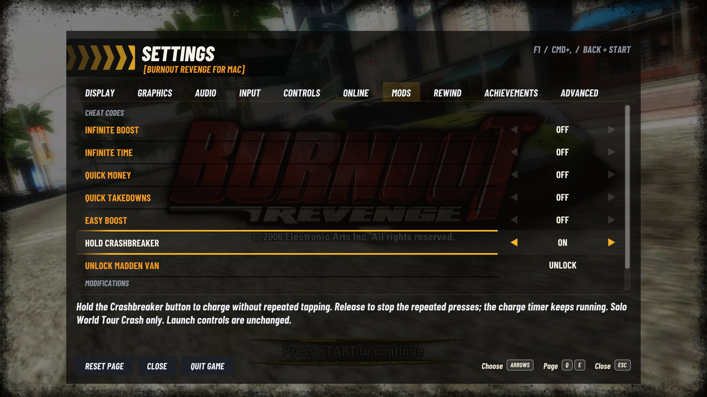

# Hold Crashbreaker

Settings > Mods > Cheat Codes > **Hold Crashbreaker** lets you hold the Crashbreaker button
instead of tapping repeatedly during its charge. It is off by default. Use the
same button or mapped keyboard key as usual. Releasing it stops the repeated
presses; the normal charge timer keeps running.

This Cheat Code automates repeated input and can make charging easier. It works
in solo World Tour Crash, including when signed in to Xbox
Live. It does not change launch controls, Classic Crash Launch, ordinary driving,
Replay, network events, or local multiplayer.

While charging, the first press passes immediately. A held button supplies eight
presses per second of game time. Pausing freezes the repetition with the game;
normal menu and focus release rules still apply. Release and hold again after
leaving a menu if the game is waiting for neutral input. Releasing the button
clears the cadence. A new charge or a rewind starts a fresh cadence. Slow frames do not queue extra presses.

The game still determines when a Crashbreaker is available, the charge drain,
boost added per press, the charge limit and the explosion strength. The option
only replaces repeated charge input, before the game records it for playback.
Other buttons and axes keep their normal behavior. No render or simulation update is added.

