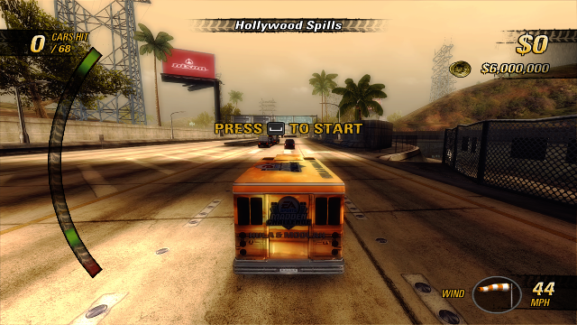

# Linux beta validation

This experimental x86-64 beta was tested **only in UTM 5.0.8 on an Apple M1 Pro
Mac with 16 GB RAM**. It is not a native Linux GPU or performance qualification.
See the package's `bundle-info.json` and `VALIDATION.json` for its exact revision.

## Environments

| Build | Guest and runtime | Graphics and presentation |
|---|---|---|
| x86-64 release package | Emulated Skylake / x86-64-v3, 2 CPUs, 4 GB RAM; Ubuntu 22.04.5 / HWE 6.8; Ubuntu 24.04 runtime container | Mesa 25.2.8 / Virtio-GPU Venus / Apple M1 Pro; Wayland, headless Weston with virgl GL; offscreen checked separately |
| ARM64 diagnostics | 4 CPUs, 8 GB RAM; Ubuntu 26.04 | Mesa 26.0.8 / Venus; GNOME Wayland |
| macOS regression | Apple M1 Pro, native ARM64 build | macOS; installed stable v0.1.26 was preserved |

Venus forwards rendering to the Mac GPU. The container supplies newer userspace
libraries; it is not another CPU/GPU emulator. ARM64 evidence does not qualify
the x86-64 release package. VM FPS is not a minimum-hardware specification.

## Automated tests

- Full Linux ARM64 suite: **163/163**, 40.65 seconds.
- Full macOS regression suite: **157/157**, 48.67 seconds. An earlier isolated
  system-clock monotonicity failure and subsequent passing retries remain
  recorded; the final full run passed.
- Native x86-64 guest suite with ASan/LSan: **160/163 initially**, while the game
  was running. All three rechecks passed: unchanged music-index throughput
  assertion, 0.90 seconds; pixel oracle, 400.76 seconds with a 600-second runner
  budget; clock stress, 20,000 suspension cycles and 441,025,948 readings,
  147.7 seconds of stress with an explicit 600-second watchdog. The default
  watchdog remains 120 seconds, and workload/assertions were not reduced.
  This was a full run plus rechecks, not a single clean 163/163 run.
- Asset-free public CI: **44/44** on
  [53db233](https://github.com/secretpray/burnout-revenge/actions/runs/40354703323).
  Public CI contains no game assets or generated PowerPC code.
- Per-user installer: seven synthetic cases on actual x86-64 Linux, including
  GIO launching, paths with spaces/special characters, updates, corrupted
  packages, foreign shortcuts, install locking and save preservation.

The functional runtime is `5bfc9d0b`. Later clock-test/documentation changes
retain identical `runtime` and `recomp` source trees; the final package is also
checked independently. Tests do not establish physical input or audio quality.

## Runtime checks

| Check | Evidence and scope |
|---|---|
| x86-64 gameplay | Packaged Traffic Attack: steering, traffic, collisions, HUD, OK result ($7,775, no medal), Replay |
| x86-64 saves | Native Player File save (3 writes, 21,316 bytes), process exit, restart and Load Successful with the same isolated data |
| App installation | Empty home, custom XDG paths, ordinary user, read-only bundle/game source, no developer PATH; supported game files installed and verified; update retains data |
| ARM64 solo modes | Race result/Replay, Burning Lap driving, Traffic Attack result, Crash result ($145,350), Road Rage result (one takedown, no medal), Eliminator driving |
| ARM64 Rewind | Native Race restores of 10.317, 20.817 and 30.950 seconds, with RNG/deadline state restored |
| ARM64 Classic Crash Launch | On → Retry → Off → Retry in one process, settings log and launch-meter captures |
| ARM64 split screen | Two virtual controllers, two rendered views for at least 30 minutes after race start; player 1 finished first while player 2 continued driving; not a physical-controller check |
| ARM64 network | Two Linux clients on loopback: lobby, shared session, driving, race end and next race; 600 seconds each, clean bounded exits |
| Mac–Linux network | Native Mac host and ARM64 Linux guest: race, race end, next race; 600.5/600.8 seconds, clean bounded exits |
| ARM64 Burnout Clips | Native Share Clip uploaded body (185,051 bytes) and header (12,544 bytes), reached Clip Shared; a second persona found it in Top 20, downloaded and played it in Clip Viewer |
| Locker transport | Linux server: synthetic two-part PUT/GET/DEL (1 KiB + 256 KiB), cross-persona read and foreign-write rejection |
| x86-64 endurance | 3,902.33 seconds, clean bounded exit; gameplay/results/Replay/menu mix, not 65 minutes of continuous driving; 128 memory samples, last half 991–1,012 MiB RSS |

Every automated gameplay run used scripted or SDL virtual controls and was
muted. Saves/settings were scratch data. No OS keyboard injection was used.

## Known issues and untested checks

- **Black menu-video backgrounds on x86 Venus**, reproduced in Wayland and
  offscreen rendering. 3D gameplay renders. This remains an unresolved visual
  issue in the tested environment.
- Xvfb lacks DRI3 for this Vulkan device; Weston with pixman cannot provide its
  required surface path. These failed environments are not X11 qualification.
  A failed video initialization now exits clearly before loading the game.
- Native AMD/Intel/NVIDIA GPUs, Steam Deck/SteamOS, normal x86 desktop
  compositors, real-hardware performance and native GPU endurance: untested.
- Physical controllers, keyboard mappings, rumble, USB/Bluetooth/Steam Input,
  listening, device switching, sleep/resume and display changes: untested.
- The sharing persona’s own clip is omitted from Top 20 by the game; a second
  test persona downloaded and played it. Friends services and full Internet
  NAT/router compatibility remain outside these local-network checks.
- Nine-language catalog and audio decoder fixture tests passed; this does not
  mean every language was manually played or the soundtrack was listened to.

Report issues with revision, distro/kernel, CPU/GPU/driver, display session and
an app bug-report archive. Do not upload disc images, game files or saves.
